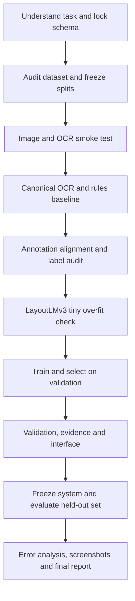

# ReceiptSense - step-by-step project plan

Date: 23 October 2026. Read with [the project overview](README.md) and [source requirements](docs/00_SOURCE_AND_REQUIREMENTS.md).

## 1. Intended outcome

Build a local, inspectable receipt extraction system. A user uploads a printed receipt image, receives company/address/date/total predictions, sees the supporting regions, corrects uncertain fields, and exports structured data. Compare a rules baseline and a fine-tuned LayoutLMv3 extractor on identical held-out inputs.

This document preserves the implementation plan written before development. **The software is now implemented**; [RUNNING.md](RUNNING.md) gives actual commands, and [the implementation report](report/IMPLEMENTATION_REPORT.md) records measured outcomes. The original detailed checklists remain as team acceptance and follow-up checklists; use the execution summary below for the current build status.

| Plan steps | Executed outcome |
|---|---|
| 1-2: scope and contracts | Four fields, shared validated records, evidence and append-only reviews implemented |
| 3-4: data audit and splits | Pinned mirror; 550 train, 61 validation, 358 test; exclusions and duplicate review saved |
| 5-8: environment, images, OCR, rules | Real OCR and both runtime adapters checked; image transforms, cache and rules implemented |
| 9: supervision | 526 usable weak/partial alignments; 37 fully aligned; eight visually audited training receipts, below the original 20-30 target |
| 10-12: encoding and learning | Long-window mapping tested; tiny head fit passed; frozen-backbone head trained, selected at epoch 7, and reloaded with identical fields on all 61 validation receipts |
| 13-14: application | Validation, evidence, editable fields, saved history, JSON/CSV, Streamlit and optional FastAPI implemented and exercised |
| 15-16: experiments | Full paired held-out comparison; fixed 12-parent/six-condition probe; 10-receipt uncached timing; error ledger saved |
| 17: report | Measured report and error analysis supplied; fourteen screenshot areas remain blank as requested |
| 18: reproduction | Pinned assets/lock and commands supplied; fresh-process model reload verified; a complete second-machine installation and team viva are not claimed |

The executed learned mode is classifier-head adaptation, not all-parameter fine-tuning. The strict overall comparison did not show an improvement over rules. These limits are part of the delivered result.

### Novelty extension on a separate branch

The approved extension is implemented on `feature/adaptive-receipt-recovery`: a multi-line address graph, up to two selective crop OCR retries, evidence/audit metadata, four UI/API/CLI modes, validation ablations, and private confirmation collection/freeze tooling. Read [the novelty roadmap](docs/14_NOVELTY_ROADMAP.md) and [its measured report](report/NOVELTY_REPORT.md). The original checkpoint stays fixed and Baseline remains the default. The 50-receipt Indian confirmation study remains pending team collection and independent annotation.

## 2. Order of work

Image quality experiments can begin once the baseline works. UI work can use clearly labelled fixtures once the shared schema is frozen. Final results depend on real pipeline outputs.

## 3. Step-by-step execution

### Step 1 - Read the source and agree the task

- [ ] Read [01 - Understanding](docs/01_PROJECT_UNDERSTANDING.md), then papers P02 and P01 in that order.
- [ ] Confirm four required fields and what counts as a printed receipt.
- [ ] Agree English/Latin-script receipts as the initial engineering scope, subject to dataset audit.
- [ ] Define one image as one receipt and record unsupported cases.
- [ ] Separate required work from BROS, TrOCR, Donut, multilingual support, and line-item extraction.

**Produce:** a signed-off scope note and updated requirement map. **Done when:** every team member can explain why recognizing an amount does not identify the total. **Depends on:** nothing.

### Step 2 - Freeze the shared record format

- [ ] Adopt the image, OCR, field prediction, and reviewed record contracts in [02](docs/02_ARCHITECTURE_AND_DATA_CONTRACTS.md).
- [ ] Decide file IDs, schema version, coordinate frames, null handling, and raw versus normalized values.
- [ ] Specify immutable predictions and separate correction events.
- [ ] Create one synthetic fixture that travels through every module.

**Produce:** schema specification, valid and invalid fixtures. **Done when:** baseline, model, UI, and evaluator accept the same record without ad hoc conversion. **Depends on:** 1.

### Step 3 - Audit and register the actual dataset

- [ ] Obtain SROIE from an authorized source; record release, terms, archive hashes, and provenance.
- [ ] Count images, OCR annotation files, and entity files; pair by stable IDs.
- [ ] Inspect 20 training receipts and annotation granularity, without selecting attractive test examples.
- [ ] Check duplicates, malformed coordinates, missing entity labels, and OCR transcript formatting.
- [ ] Write an exclusion ledger before seeing system predictions.

**Produce:** dataset card and inventory CSV. **Done when:** every usable receipt has a traceable image and known label availability. **Depends on:** 1-2. **Guide:** [03](docs/03_DATASET_AND_ANNOTATION.md).

### Step 4 - Create immutable train/validation/test manifests

- [ ] Preserve any official test split supplied by the chosen release.
- [ ] Reserve about 10% of the remaining training IDs for validation with seed 42, grouping duplicates first.
- [ ] If the release has no trusted split, document a new receipt-group split before development.
- [ ] Store lists and hashes; verify disjoint source IDs and duplicate groups.
- [ ] Keep all degraded or augmented copies in their parent receipt's split.

**Produce:** three manifests and a leakage check. **Done when:** a second machine reconstructs the same IDs. **Depends on:** 3. Do not tune normalization, rules, thresholds, or augmentation on test labels.

### Step 5 - Verify the environment on a tiny example

- [ ] Record OS, Python, CPU/RAM, GPU/VRAM if available, and framework versions.
- [ ] Test image loading and one explicitly selected PaddleOCR detector/recognizer.
- [ ] Check whether real word boxes are available; record line boxes honestly if they are not.
- [ ] Load the LayoutLMv3 processor and token classifier in a suitable environment; run one synthetic input.
- [ ] Pin the working versions and model revisions after the smoke test.

**Produce:** setup instructions and environment manifest. **Done when:** one image yields text/regions and the model forward pass returns finite outputs. **Depends on:** 2. **Guide:** [11](docs/11_ENGINEERING_AND_REPRODUCIBILITY.md). No full training yet.

### Step 6 - Implement conservative image preparation

- [ ] Validate decode, dimensions, file limits, color channels, and EXIF orientation.
- [ ] Start with identity processing; add deskew/perspective correction as explicit variants.
- [ ] Preserve the original, processed image, transform chain, and coordinate frames.
- [ ] Build overlays that map selected regions back to the displayed image.
- [ ] Inspect representative training cases for clipped text and processing damage.

**Produce:** preprocessing module and transform metadata. **Done when:** known landmarks map correctly between frames and no receipt silently loses text. **Depends on:** 2,5. **Guide:** [04](docs/04_IMAGE_PREPROCESSING.md).

### Step 7 - Build a versioned OCR adapter and cache

- [ ] Convert the selected engine output into the canonical OCR record.
- [ ] Preserve text, polygons, confidence, line/word granularity, and reading order.
- [ ] Establish deterministic region IDs and line grouping.
- [ ] Key the cache by image hash, processing configuration, engine/checkpoint revision, and adapter version.
- [ ] Treat empty OCR as a structured failure state.

**Produce:** OCR JSONL/cache and overlay samples. **Done when:** both extractors consume the identical cached OCR objects for a given experiment variant. **Depends on:** 6. **Guide:** [05](docs/05_OCR_AND_READING_ORDER.md).

### Step 8 - Build the rules baseline first

- [ ] Propose candidates for each field using text patterns and layout.
- [ ] Rank total candidates using explicit keywords and neighboring regions; penalize subtotal, cash, and change.
- [ ] Keep reasons and supporting region IDs; allow null/ambiguous results.
- [ ] Develop only on train/validation receipts.
- [ ] Run a first validation evaluation using the final schema.

**Produce:** baseline outputs, versioned rule configuration, validation table. **Done when:** a difficult total-versus-cash example is explainable and no “largest number” shortcut is hidden. **Depends on:** 7. **Guide:** [06](docs/06_RULES_BASELINE.md).

### Step 9 - Construct and inspect field-to-region supervision

- [ ] Align the four ground-truth strings to OCR units using normalized exact candidate spans first.
- [ ] Handle multiline fields, repeated amounts, commas in annotation text, and unmatched OCR.
- [ ] Mark uncertain spans for manual review; do not label every unmatched unit as `O` automatically.
- [ ] Audit 20-30 training receipts, increasing the audit if systematic errors occur.
- [ ] Report coverage per field and label provenance; use the same approved policy for validation.

**Produce:** labelled OCR records, ambiguity queue, alignment audit. **Done when:** a human can trace every audited positive label to its field and box. **Depends on:** 3,4,7. **Guide:** [03](docs/03_DATASET_AND_ANNOTATION.md). This is a training blocker, not a cleanup task after training.

### Step 10 - Encode LayoutLMv3 inputs correctly

- [ ] Use the selected RGB image, external OCR units, and 0-1000 normalized boxes with internal OCR disabled.
- [ ] Freeze nine BIO labels and processor/model revision IDs.
- [ ] Align OCR units to subwords; supervise first subwords and mask other positions consistently.
- [ ] Window long receipts without silently dropping the bottom total.
- [ ] Retain mappings from windows to original OCR IDs for decoding and evidence.

**Produce:** encoded training examples and visual label checks. **Done when:** every supervised position has the intended unit, box, and label, including a long receipt. **Depends on:** 9. **Guide:** [07](docs/07_LAYOUTLMV3_TRAINING.md).

### Step 11 - Pass a tiny overfit check

- [ ] Train on 8-16 audited training receipts using fixed settings.
- [ ] Inspect loss, predictions, label distribution, and decoded fields on that same tiny subset.
- [ ] Investigate a model that predicts only `O`, has invalid loss, or cannot learn obvious examples.
- [ ] Discard this diagnostic score as a generalization result.

**Produce:** diagnostic log and known-good training path. **Done when:** the model can substantially fit the tiny verified subset and recover fields. **Depends on:** 10. Never report this as test accuracy.

### Step 12 - Train and select on validation

- [ ] Start from the proposed small-run configuration in module 07.
- [ ] Save processor, label map, weights, split hash, OCR fingerprint, and hyperparameters together.
- [ ] Decode full fields and select the checkpoint by validation macro field exact match.
- [ ] Use a small prespecified search; log failed runs and resource limits.
- [ ] Repeat the chosen configuration with additional seeds if resources permit.

**Produce:** selected checkpoint and validation predictions. **Done when:** a fresh process reproduces the selected validation outputs. **Depends on:** 11. The pretrained base checkpoint alone is not a receipt extractor.

### Step 13 - Add shared validation and evidence

- [ ] Parse dates conservatively and keep ambiguous dates unresolved.
- [ ] Parse amounts using decimal arithmetic, retaining source text and currency uncertainty.
- [ ] Produce review reasons for missing, conflicting, or weak evidence.
- [ ] Highlight selected OCR regions; keep uncertain suggestions editable.
- [ ] Freeze any override policy on validation; evaluate overrides as a separate variant.

**Produce:** validated predictions and review flags. **Done when:** every populated raw field has source evidence and every changed normalized value has a recorded transformation. **Depends on:** 8,12. **Guide:** [08](docs/08_VALIDATION_AND_HUMAN_REVIEW.md).

### Step 14 - Build the local upload-to-export interface

- [ ] Use Streamlit as the initial local UI, calling a shared pipeline function.
- [ ] Add receipt preview, processing state, field table, evidence selection, and correction controls.
- [ ] Save reviewed records separately from immutable predictions.
- [ ] Export JSON with provenance and flat CSV with safe text handling.
- [ ] Add FastAPI only if a separate client or process boundary is needed.

**Produce:** working demo and example exports. **Done when:** another team member can complete upload, inspect, correct, and export without editing source files. **Depends on:** 2,13. **Guide:** [09](docs/09_APPLICATION_AND_EXPORT.md).

### Step 15 - Freeze and run controlled evaluation

- [ ] Freeze checkpoint, rules, parser/decoder versions, thresholds, preprocessing, metrics, and test manifest.
- [ ] Run raw OCR + rules and raw OCR + LayoutLMv3 on the same held-out receipt IDs.
- [ ] Run correction variants separately with matching OCR inputs per pair.
- [ ] Count nulls, crashes, and unsupported-but-in-scope images as failures under the frozen scoring policy.
- [ ] Save per-receipt predictions before calculating summaries; keep corrections out of automated scores.

**Produce:** immutable test outputs and result tables. **Done when:** all result denominators, configurations, and seeds are recoverable. **Depends on:** 12-14. **Guide:** [10](docs/10_EVALUATION_AND_EXPERIMENTS.md).

### Step 16 - Analyze failure modes, robustness, and latency

- [ ] Bucket misses into image, detection, recognition, ordering, alignment, classification, decoding, and normalization causes.
- [ ] Test fixed blur/rotation/perspective variants with parent receipt groups preserved.
- [ ] Measure uncached end-to-end latency separately from cached extraction and cold startup.
- [ ] Report per-field results, all-four exact match, review rate, sample counts, and uncertainty where practical.
- [ ] Describe gains only if actually measured; report a weaker learned model honestly.

**Produce:** error ledger, robustness table, timing table, representative cases. **Depends on:** 15. Test-driven fixes require a new untouched confirmation set, or clear disclosure that the old test became development data.

### Step 17 - Fill screenshots and complete the report

- [ ] Follow [the screenshot guide](report/SCREENSHOT_GUIDE.md); replace each blank placeholder with evidence from the actual build.
- [ ] Complete dataset, environment, experiment, result, and limitations sections in [the report](report/PROJECT_REPORT.md).
- [ ] Replace every `PENDING` cell with evidence or an explicit “not evaluated” statement.
- [ ] Cross-check every reported number against saved prediction files.
- [ ] Cite literature for methods and your runs for measured results.

**Produce:** final project report with captions, references, results, and honest limitations. **Depends on:** 15-16. Screenshot capture is intentionally postponed.

### Step 18 - Reproduce and package the final submission

- [ ] Rebuild the environment on a clean machine/session using the lock file.
- [ ] Run the demo and evaluator with the saved artifacts.
- [ ] Confirm screenshot links, exports, model loading, and dataset access instructions.
- [ ] Package code/configuration, allowed artifacts, documentation, and report; keep third-party papers attributed.
- [ ] Rehearse the viva and a failure-case demonstration.

**Produce:** reproducible submission and short demo script. **Done when:** an uninvolved reader can run a receipt and understand the claims. **Depends on:** 17. **Guide:** [11](docs/11_ENGINEERING_AND_REPRODUCIBILITY.md), [13](docs/13_TEAM_SCHEDULE_AND_VIVA.md).

## 4. Acceptance gates

| Gate | Required evidence | Blocks |
|---|---|---|
| G0: contract | Scope and common schema agreed | Module integration |
| G1: data | Audited release, fixed IDs, no split leakage | Training and headline evaluation |
| G2: OCR | Real boxes/granularity, aligned overlays, valid cache | Supervision and evidence UI |
| G3: labels | Field alignment coverage and reviewed samples | Full model training |
| G4: training | Tiny overfit check and reloadable checkpoint | Training scale-up |
| G5: product | Upload, evidence, correction, export work | Final demonstration |
| G6: science | Frozen methods and complete held-out results | Performance claims |
| G7: delivery | Reproduction check, report and screenshots | Submission |

## 5. Time budget and fallback

Use the [six-week schedule](docs/13_TEAM_SCHEDULE_AND_VIVA.md) as an example, not a deadline supplied by the source. The critical path is data audit -> OCR -> label alignment -> model training -> held-out evaluation. Build UI fixtures alongside training only after the schema is stable.

If GPU access is delayed, finish the OCR/rules interface, annotation audit, evaluator, and report structure while arranging a training environment. This is useful progress; it does not satisfy the planned learned-extractor comparison. Drop optional alternatives before weakening the required evidence and evaluation.

## 6. Completion ledger

| Deliverable | Current state |
|---|---|
| Source review, plan, module documentation | Complete |
| Nine reference PDFs and individual notes | Imported and documented; see manifest |
| Report and screenshot placeholders | Measured implementation report and error analysis supplied; original fourteen blanks retained |
| Dataset and trained checkpoint | Audited 550/61/358 split; selected trained classifier-head bundle and reload check saved |
| Application and automated tests | Implemented; 29 automated tests pass, plus real OCR API/browser workflow checks |
| Experiment results and screenshots | Full held-out, robustness and timing artifacts saved; report screenshot areas remain blank |
