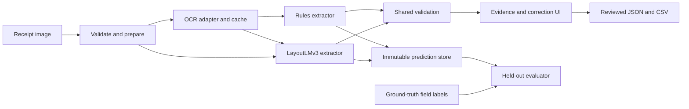

# 02 - Architecture and shared data contracts

[Index](../README.md) | Previous: [understanding](01_PROJECT_UNDERSTANDING.md) | Next: [dataset](03_DATASET_AND_ANNOTATION.md)

## Responsibility and boundary

This document defines how the whole project fits together. It is the common specification for every implementation module. The records below are **proposed contracts**, not existing software outputs.



The selected image and its OCR boxes must describe the same geometry. Both extractors receive the same OCR record for a given experimental condition. The evaluator reads saved automated predictions; user corrections go through a separate path.

## A. Image record

Required metadata: `receipt_id`, source image SHA-256, original filename for display only, decode status, original dimensions, display dimensions after EXIF handling, processed dimensions, preprocessing configuration hash, coordinate transform chain, and selected image path/ID.

Use three explicit frames:

1. `raw`: decoded stored pixels before EXIF orientation.
2. `display`: orientation-corrected original shown to the user.
3. `processed`: image used for OCR and the extractor.

A transform names its source/destination frames and stores the affine/homography matrix where applicable. For a point in display coordinates, `p_processed ~ H_display_to_processed @ p_display`. Convert homogeneous points back by dividing by their third component. Use the inverse to highlight processed polygons over the display image.

If a future non-linear unwarping operation has no reliable inverse, display the evidence on the processed image and name the frame explicitly. A falsely aligned original-image highlight is unacceptable.

## B. OCR record

Illustrative record for a synthetic amount region:

```json
{
  "schema_version": "1.0",
  "receipt_id": "illustration-001",
  "image_frame": "processed",
  "image_width": 1000,
  "image_height": 2000,
  "ocr_fingerprint": "ILLUSTRATIVE",
  "units": [
    {
      "unit_id": "u0001",
      "text": "493.50",
      "granularity": "word",
      "polygon": [[700, 1500], [900, 1500], [900, 1540], [700, 1540]],
      "bbox_xyxy": [700, 1500, 900, 1540],
      "recognition_score": 0.91,
      "line_id": "l0012",
      "reading_order": 17,
      "box_source": "engine"
    }
  ]
}
```

The numbers are illustrative. Recognition scores retain engine semantics; they are not field correctness probabilities. Preserve native region IDs/polygons before converting to axis-aligned model boxes. If no word geometry exists, use `granularity: "line"` or mark replicated line boxes with `box_source: "replicated_line"`.

Invariants: unique IDs, deterministic order, finite coordinates, nonempty valid regions, known frame, matching image dimensions, and equal lengths of model word/box arrays. A region outside bounds beyond rounding tolerance is an error to investigate, not silently normalize away.

## C. Automated field prediction

Each receipt has all four keys, including missing fields. Each field contains:

| Key | Type and rule |
|---|---|
| `raw_value` | String from selected OCR units, or null |
| `normalized_value` | Conservative parsed value as a string, or null |
| `evidence_unit_ids` | List of existing OCR unit IDs; empty for missing prediction |
| `status` | `predicted`, `ambiguous`, `missing`, or `invalid` |
| `score` | Nullable numeric diagnostic; accompanied by `score_kind` |
| `score_kind` | Such as `heuristic` or `uncalibrated_token_aggregate` |
| `review_reasons` | Stable reason codes, e.g. `multiple_total_candidates` |
| `normalization_actions` | Operations applied to the raw value |

Total metadata may include `currency`, which stays null unless explicit evidence or an agreed external context supports it. Date metadata may contain alternative parses; ambiguity means the normalized date remains null.

A top-level prediction also needs `prediction_id`, `receipt_id`, creation timestamp, schema version, `method`, checkpoint/rules revision, OCR fingerprint, decoder version, validation version, configuration hash, per-stage timings, and errors. `method` identifies rules, learned, or a separately evaluated combined variant.

**Example:** raw total `493.50`, normalized total `493.50`, currency null, evidence `["u0001"]`. No OCR evidence should be invented for a missing amount. A base language model's guessed company name is outside this extraction contract.

## D. Training annotation record

Keep reference entities separate from predictions. Store receipt ID, split, reference field strings, aligned unit IDs, BIO label per OCR unit, `label_provenance` (`exact_match`, `manual`, `silver`), unresolved spans, ignored unit IDs, annotation policy version, and reviewer note where relevant.

The same numeric amount can occur in subtotal and total. Matching the string alone is insufficient evidence to choose its BIO span. Annotation requires context or manual review. The final field evaluation still includes receipts whose OCR could not express the target.

## E. Reviewed record and correction event

`review_id` points to an immutable `prediction_id`. Save the final four accepted values, review status, timestamp, and changed fields. A correction event records field, previous raw value, edited value, optional selected evidence, and event time.

Typed text can lack OCR evidence; mark it `user_entered` and preserve that distinction. A corrected record must not replace the automated value in the result files. Editing invalidates any previous “confirmed” state until the user explicitly confirms again.

## Proposed module interfaces

These signatures describe responsibilities; they are not callable functions yet.

```text
prepare_image(upload, preprocessing_config) -> ImageRecord
run_ocr(ImageRecord, ocr_config) -> OCRRecord
extract_rules(OCRRecord, rules_config) -> PredictionRecord
extract_layout(ImageRecord, OCRRecord, model_bundle) -> PredictionRecord
validate_fields(PredictionRecord, validation_config) -> ValidatedPrediction
save_review(prediction_id, edits, confirmation) -> ReviewedRecord
export_record(ReviewedRecord, format) -> ExportArtifact
evaluate(prediction_file, reference_file, metric_config) -> MetricsAndErrors
```

## Failure behavior

Distinguish unsupported upload, decode failure, OCR failure, empty OCR, model unavailable, no field evidence, and export failure. Return structured errors and a visible next action. An operational model failure may offer a clearly identified rules fallback; score this fallback as a separate method/policy rather than silently counting it as model success.

## Completion checks

- A synthetic record passes through baseline, learned-decoder fixture, validation, review, and export.
- Every evidence ID exists in the associated OCR record.
- Image overlays align after rotation and a perspective transform.
- Repeated processing with the same artifact/configuration fingerprints is traceable.
- Corrections cannot mutate stored automated predictions.

Continue to the dataset document before building real training tensors.
