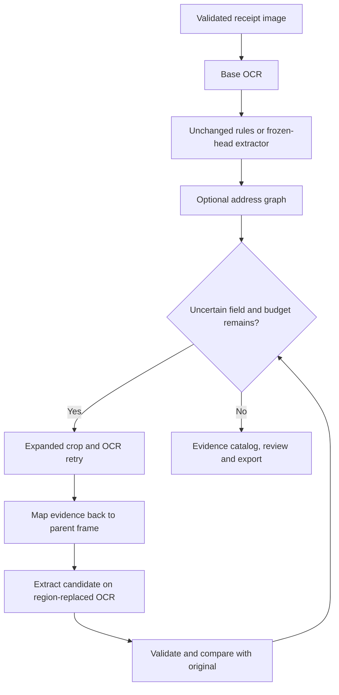

# 14 - Selective receipt recovery and address reconstruction

[Project index](../README.md) · [Run guide](../RUNNING.md) · [Measured novelty report](../report/NOVELTY_REPORT.md)

## Goal and contribution

The original prototype compares OCR/rules with a frozen-backbone LayoutLMv3 classifier head. Its address exact match is weak and its review signals are uncalibrated. This branch adds a geometry-based address graph and a bounded strategy for re-reading uncertain regions. The research question is whether these additions correct enough errors to justify their OCR cost and any new errors they introduce.

These are project-level method and evaluation contributions. We do not claim to invent OCR, spatial document models, uncertainty-based routing, or human review. We do not claim a calibrated risk guarantee. The existing head and OCR weights remain fixed; full fine-tuning, active learning and regional-script support are outside this version.

## Branch and baseline

- Branch: `feature/adaptive-receipt-recovery` in `aditya9515/recipet-Scense`.
- Original baseline: `12dc9749ee77df55c04e7443ecc404b37009e280`.
- [Preserved baseline identity](../results/novelty/baseline_manifest.json) records checkpoint hashes, OCR identity, dependencies and hashes of original published results.
- Changes are committed to the feature branch and submitted as a draft PR. `main` is not merged or overwritten.
- The original fourteen report screenshot areas stay blank for the team.

## Processing modes and data flow

| Mode | Address graph | Additional OCR |
|---|---|---|
| `none` / Baseline | No | No |
| `address` / Address reconstruction | Yes | No |
| `retry` / Selective recovery | No | At most two calls |
| `combined` / Combined | Yes, including retry candidates | At most two calls |

## Address graph

1. Group OCR units into lines and separate distant horizontal columns.
2. Search the upper half of the receipt, with a 120-node and 4,096-path bound.
3. Connect vertically ordered neighboring lines using line-height-relative gaps and horizontal overlap/alignment.
4. Start candidate blocks at street/building/postal clues. Allow a postal-code-only continuation.
5. Stop at contact, registration, tax, transaction, date, item or payment content, including common OCR-glued labels such as `DATE03/04/2025`.
6. Score supported blocks using street terms, leading building numbers, five-/six-digit postal patterns, location clues and line count. These are heuristics, not probabilities.
7. Preserve verbatim OCR tokens, newlines and evidence IDs. Retain competing blocks as alternatives when the score margin is insufficient.

The versioned configuration is `configs/recovery-v1.json`. A predeclared six-choice validation sweep selects vertical-gap factors `{1.5, 2.0, 2.5}` and overlap thresholds `{0.2, 0.4}`. Selection uses mean strict address EM across both extractors, with overall macro EM, fewer changes, smaller gap and greater overlap breaking ties. Other constants are fixed engineering defaults. See [selection evidence](../results/novelty/policy_selection.json).

## Selective recovery

Priority is missing/invalid, then conflicts or rules/model disagreement, then weak evidence. Field ties resolve as address, total, date, company. Rules/model disagreement is available when the selected extractor is LayoutLMv3; rules-only processing does not implicitly load another model.

The first attempt expands the supporting region, keeps full line width for label context, and enlarges RGB up to 2x with a maximum side of 1,600 pixels. Missing company/address uses the header; missing total uses the payment region; missing date uses the upper receipt. If the field remains unresolved, the second attempt uses mild CLAHE on the same region. Otherwise the remaining call targets the next uncertain field.

An absent, invalid or ambiguous original can be replaced by a valid, unambiguous, sufficiently supported candidate. A usable original is retained unless address structural evidence improves or the selected learned extractor and rules corroborate the replacement. Higher OCR confidence alone cannot change a usable total/date/company. Rejected differences remain alternatives with a review reason. OCR failures preserve the original field and produce a trace.

Two logical attempts are the hard limit, including cache hits. Actual engine calls are counted separately. There is no wall-clock guarantee; measured CPU latency is reported instead.

## Evidence, caching and compatibility

- Keep the original OCR artifact immutable. Candidate extraction replaces OCR inside one crop rather than concatenating duplicate original/retry text.
- Every retry unit receives an attempt-prefixed ID and source marker. Retry polygons map through the inverse crop transform into the parent's processed frame; the existing image transform maps them onto the displayed original.
- The final OCR is an evidence catalog, containing original and attempted units for inspection. It is never passed back to the model as a concatenated document.
- Cache keys include source-image hash, crop image/hash/geometry, preparation, configuration and engine fingerprint. Pipeline fingerprints identify a configuration, not receipt-specific crop outcomes.
- Prediction recovery metadata records baseline fields, address decisions, attempt regions, candidates, accept/reject reasons, logical attempts, actual OCR calls and elapsed time.
- Existing predictions/reviews load with optional defaults. Immutability comparison normalizes old records through the same contract. JSON includes full provenance; CSV adds processing mode and retry counts.
- Baseline remains the default. Validation may establish eligibility for a future default change; no automatic default switch is made from a small development result.

## Development and evaluation protocol

1. Keep the existing head fixed and select graph thresholds on the 61 validation receipts.
2. Compare both extractors under all four modes on those identical receipt IDs.
3. Save predictions before calculating aggregate metrics; count failures and missing fields in full denominators.
4. Report strict/normalized field and all-four EM, address token F1, corrected fields, introduced errors, review/retry rates and OCR calls.
5. Measure uncached latency separately with ten validation receipts, one warmup per condition and rotating condition order. Accuracy-run cache timing is not uncached timing.
6. Freeze policy/configuration/checkpoint identity before new confirmation. The previously inspected 358-receipt test set is not used as new confirmation.

Address token F1 is case-insensitive bag-of-word overlap, including numbers; it supplements exact match and does not replace it. Validation bootstrap intervals are exploratory receipt resamples. Fresh confirmation additionally clusters resamples by merchant, with seed 42 and 1,000 resamples. Ten merchants remain a small pilot.

## Fresh confirmation collection

Target: 50 English/Latin-script Indian printed receipts, ten merchants and five distinct transactions per merchant. All four target fields must be visibly present. Select receipts before inspecting predictions. Two people independently transcribe the four strings; disagreements require a third reviewer and an explicit resolution. Log collection exclusions before inference, never remove extraction failures after scoring.

The local `confirmation-init` command creates CSV templates, an image folder and instructions under ignored `data/confirmation/`. `confirmation-freeze` checks annotation agreement/adjudication, image uniqueness/development overlap, counts, formats and a completed validation run using the same policy. It writes an immutable manifest and a lock covering images, annotation sources, configuration, policy and checkpoint. The checks verify supplied records; they cannot prove human independence or that selection actually preceded inspection.

`confirmation-evaluate` rejects changed images, labels, annotation sources, configuration, policy or checkpoint. It keeps detailed predictions local and produces an aggregate summary. Do not tune on confirmation outcomes; a changed method requires a new untouched confirmation study or an exploratory designation.

**Privacy:** images, transaction-level labels, merchant mapping, predictions, locks and correction history stay local. The publication snapshot is an explicit allowlist of aggregate evidence. Do not force-add private receipt data or screenshots without explicit approval and redaction.

## Acceptance gates

- [x] Preserve the original baseline and isolate branch work.
- [x] Implement the address graph and bounded recovery.
- [x] Integrate four modes, trace inspection and exports across UI/API/CLI.
- [x] Test coordinate transforms, missing OCR, retry failures, hard budget, conflicts, old history and export behavior.
- [x] Complete measured validation ablations and uncached latency; see the generated report for actual outcomes.
- [x] Complete final browser/API verification, including edits, confirmation, exports and the eight-condition notebook.
- [ ] Team supplies and verifies the 50 real confirmation receipts.
- [ ] Run frozen confirmation and update empirical conclusions.

Software delivery can finish before collection. Positive novelty results cannot be claimed until measured. Screenshots and a more complicated architecture do not establish an accuracy gain.

The confirmation lock also covers the selected OCR engine fingerprint and the evaluation/collection protocol source, so changing OCR backend or scoring code after freezing is rejected. Publication is through the named feature branch and a draft PR; GitHub provides the delivery status.
