# ReceiptSense

## An Inspectable Computer Vision Pipeline for Receipt Information Extraction

**Institution:** Manipal Academy of Higher Education  
**Topic:** Document Image Analysis  
**Prepared:** 23 October 2026  
**Guide / course code / submission date:** PENDING - insert verified course details  
**Report status:** Detailed design and screenshot companion. Current implementation and measured results belong to [IMPLEMENTATION_REPORT.md](IMPLEMENTATION_REPORT.md); the fourteen blank screenshot areas here remain for you to fill.

| Registration number | Team member |
|---|---|
| 230968014 | PANDIRI JASWANTH KUMAR |
| 230968316 | KOSURU VENKATA SAI ADITYA |
| 230968304 | PERIVELA VENKATA SRI SATYA PHANI PRITHVIRAM |
| 230968140 | GORASA SAKETH RAM |

This companion expands the supplied [brief literature review](../downloadfile.pdf) and preserves the original design/template. Its **PENDING** tables and blank screenshot areas are editable layout aids. Use the separate generated implementation report and saved artifacts for actual dataset, training, verification and performance claims.

## Abstract

ReceiptSense is a proposed document image analysis system for extracting company name, address, date and total amount from printed receipt images. The planned pipeline combines conservative image preparation, pretrained optical character recognition, a transparent rules baseline and a fine-tuned LayoutLMv3 extractor. OCR text and region geometry are retained so that users can inspect evidence for each field, correct uncertain values and export a reviewed structured record. The evaluation design compares extraction methods using the same OCR outputs and held-out receipt IDs, while examining image correction, OCR failures, selected degradations and processing latency. The expected deliverable is an inspectable and reproducible academic prototype. Its actual extraction quality and practical limits must be established through the experiments specified in this report; no experimental results are available at this documentation stage.

**Keywords:** receipt understanding, document image analysis, OCR, key information extraction, LayoutLMv3, human review.

## Contents

1. Introduction and motivation
2. Problem definition and objectives
3. Literature review
4. Requirements and scope
5. System architecture
6. Dataset and annotation preparation
7. Image preprocessing and OCR
8. Rules baseline
9. LayoutLMv3 adaptation
10. Validation, evidence and human correction
11. Application and export
12. Experimental protocol
13. Results to be completed
14. Error analysis and discussion
15. Limitations and future work
16. Current conclusion and finalization instructions
17. References
18. Reproducibility and evidence checklist

## 1. Introduction and motivation

Receipts contain useful transaction information, but their printed layouts vary between merchants. A photographed or scanned receipt can also be rotated, faded, blurred or geometrically distorted. Manual data entry requires a person to identify and transcribe the relevant fields.

ReceiptSense aims to assist this task by proposing four fields while preserving their image evidence. The problem involves more than transcription: a receipt may contain subtotal, tax, total, cash and change amounts, all of which can be read correctly but assigned the wrong semantic role. Layout, nearby labels and visual context therefore matter.

The proposed application supports assisted receipt indexing and expense entry. User confirmation remains part of the workflow because plausible extracted values can still be wrong.

## 2. Problem definition and objectives

Given one printed receipt image, produce a structured record containing company, address, date and total. Each automatically populated raw field should reference the OCR regions from which it was selected. Invalid or ambiguous fields should remain identifiable and editable.

### 2.1 Objectives

1. Prepare valid receipt images while preserving coordinate relationships.
2. Extract OCR text with region geometry and documented model versions.
3. Build a transparent field-extraction baseline using rules.
4. Adapt pretrained LayoutLMv3 for the same four-field output.
5. Provide evidence overlays, uncertainty flags and correction controls.
6. Export machine and reviewed records with clear provenance.
7. Compare methods through a frozen held-out evaluation and inspect failures.

### 2.2 Research questions

The principal question is whether learned extraction improves complete fields relative to rules under shared OCR conditions. Additional questions concern the effect of image correction, the contribution of OCR failures, robustness to specified degradations, review workload and end-to-end latency.

### 2.3 Constructed example

For a receipt containing subtotal 470.00, tax 23.50, total 493.50, cash 500.00 and change 6.50, the correct extracted total is 493.50. This constructed example illustrates why selecting the largest amount is insufficient. It is not experimental data.

## 3. Literature review

| Ref. | Work | Role in this project |
|---|---|---|
| [1] | LayoutLMv3 | Main pretrained document-model reference |
| [2] | SROIE | Receipt task, target fields and benchmark context |
| [3] | DBNet | Text localization foundation |
| [4] | CRNN | Sequence recognition foundation |
| [5] | LayoutLM | Motivation for combining text and layout |
| [6] | BROS | Relative spatial relationships and reading-order analysis |
| [7] | TrOCR | Optional recognition alternative |
| [8] | Donut | Optional OCR-free alternative |
| [9] | Joint receipt transformer/rules | Related hybrid extraction work |

The planned system retains an explicit OCR stage because region outputs support inspection and correction. LayoutLMv3 is the required learned extractor; BROS, TrOCR and Donut are not required additional implementations. The installed OCR detector and recognizer must be identified by their actual checkpoints rather than inferred from foundational citations.

The proposed contribution is an inspectable receipt adaptation and controlled experimental study. Existing OCR, document transformers and hybrid methods remain attributed to their authors. Detailed individual notes and original PDFs are available in the [research library](../research/README.md).

## 4. Requirements and scope

### 4.1 Functional requirements

The system should accept a supported receipt image, validate it, extract the four fields, show source regions, mark missing/uncertain values, accept user edits, save review history and export JSON/CSV. The same processing modules should support both interactive use and offline evaluation.

### 4.2 Quality requirements

Records should retain reproducible configurations and evidence IDs. Processing errors should be visible. Corrections must not overwrite automated predictions. The evaluation must use fixed receipt splits and account for failures. No numerical service-level or accuracy target is asserted without hardware/data evidence.

### 4.3 Initial boundary

The initial engineering proposal is one printed receipt per PNG/JPEG image, using an audited English/Latin-script dataset. Line-item extraction, multilingual extension, public hosting and external accounting integrations are outside the required first version. Phone photographs require separate evaluation before broad deployment claims.

## 5. System architecture

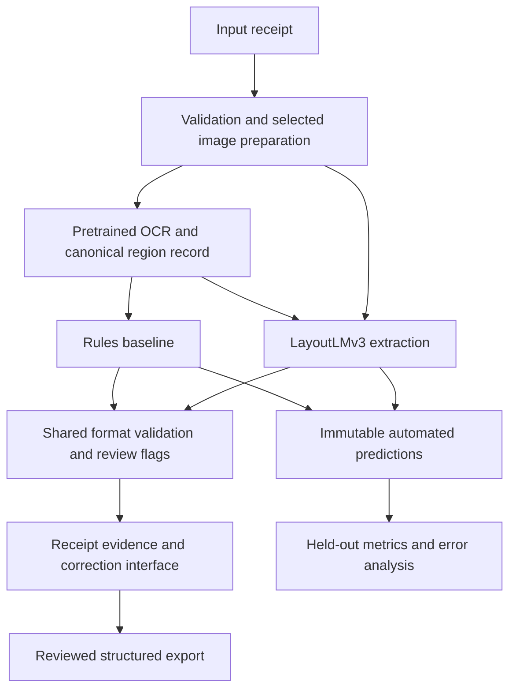

### 5.1 Shared records

Image records identify raw/display/processed frames and transform chains. OCR records contain text, polygons, granularity, scores and reading order. Field predictions contain raw/normalized values, evidence IDs, status and configuration provenance. Reviewed records link to an immutable prediction and retain edits separately.

### 5.2 Proposed stack

| Component | Proposed technology | Actual version |
|---|---|---|
| Image handling | Pillow, NumPy, OpenCV | PENDING |
| OCR | Explicitly selected PaddleOCR configuration | PENDING |
| Learned extraction | PyTorch and Transformers | PENDING |
| User interface | Streamlit | PENDING |
| Optional API | FastAPI, if needed | PENDING / not implemented |
| Local review storage | SQLite | PENDING |
| Experiment records | JSONL, configuration files and tables | PENDING |

This is a planned stack, not a statement that these application dependencies are installed or tested.

## 6. Dataset and annotation preparation

SROIE [2] provides the benchmark basis. The exact accessible release must be audited for images, box/transcript annotations and field labels. Release metadata, hashes, terms, language observations and exclusion reasons should be recorded.

### 6.1 Dataset summary to complete

| Quantity | Training | Validation | Held-out | Notes |
|---|---|---|---|---|
| Receipt images | PENDING | PENDING | PENDING | Actual usable release counts |
| Entity-labelled receipts | PENDING | PENDING | PENDING | Four-field completeness |
| OCR-annotation pairs | PENDING | PENDING | PENDING | Verified file matching |
| Duplicate groups | PENDING | PENDING | PENDING | No cross-split leakage |
| Exclusions | PENDING | PENDING | PENDING | Predeclared ledger |

**Screenshot S01 - Dataset inventory and split audit**

*Figure S01. Insert the actual dataset inventory/split evidence, including usable counts and manifest identity.*

### 6.2 Split policy

Preserve any trusted official test partition. Reserve a deterministic validation subset from training, approximately 10% under the proposed seed-42 policy, after duplicate grouping. Where official test labels are unavailable, define a labelled local holdout and identify it accurately. Augmented copies remain with their source receipt.

### 6.3 Training annotation alignment

Reference field strings must be aligned to OCR units before token classification. Exact candidate spans should be identified first; repeated values and approximate matches require contextual/manual review. Unresolved units should be ignored or the receipt quarantined from token loss instead of incorrectly labelled as outside all fields. Audit coverage and label errors per field.

| Alignment measure | Company | Address | Date | Total |
|---|---|---|---|---|
| Reference labels | PENDING | PENDING | PENDING | PENDING |
| Exact unambiguous alignments | PENDING | PENDING | PENDING | PENDING |
| Manual/silver alignments | PENDING | PENDING | PENDING | PENDING |
| Unresolved/OCR missing | PENDING | PENDING | PENDING | PENDING |

**Screenshot S05 - Audited field-to-OCR training labels**

*Figure S05. Insert an actual audited example linking reference fields to OCR text and boxes. State whether geometry is word-level or line-level.*

## 7. Image preprocessing and OCR

### 7.1 Image preparation

Initial processing validates decoding, limits, color and EXIF orientation. Identity processing is the baseline. Deskew, perspective or mild contrast correction are separate variants selected on validation. Preserve the original and the complete coordinate transformation chain.

**Screenshot S02 - Input receipt**

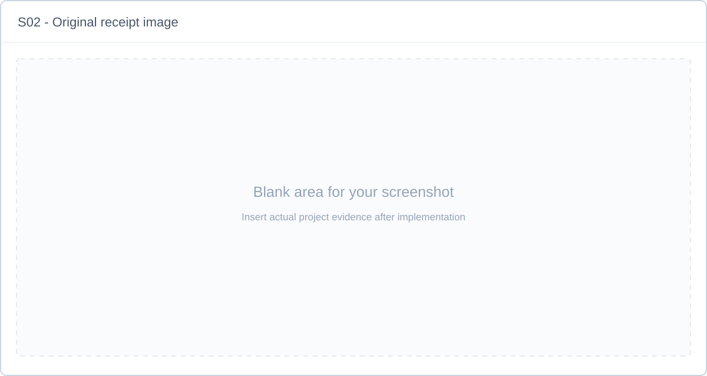

*Figure S02. Insert a genuine supported input receipt, with any required sensitive details redacted in the presentation copy.*

**Screenshot S03 - Image preparation comparison**

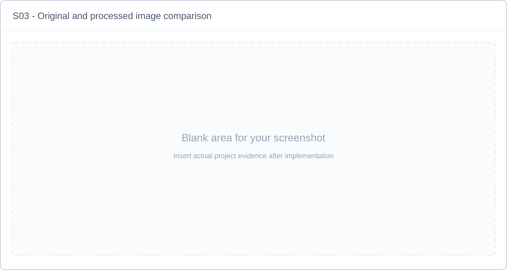

*Figure S03. Insert original/processed views with the actual transformation settings. Include a case where correction is useful or harmful in the discussion.*

### 7.2 OCR and order

The selected pretrained detector/recognizer supplies text and regions. The adapter retains native geometry and engine scores, identifies word/line granularity and creates deterministic region IDs and reading order. Cache keys include image hashes, model versions, processing settings and adapter/order revisions.

The same OCR result feeds both extraction methods within each condition. Foundational detection/recognition papers [3,4] explain these stages without establishing the installed model architecture.

**Screenshot S04 - OCR text and region overlay**

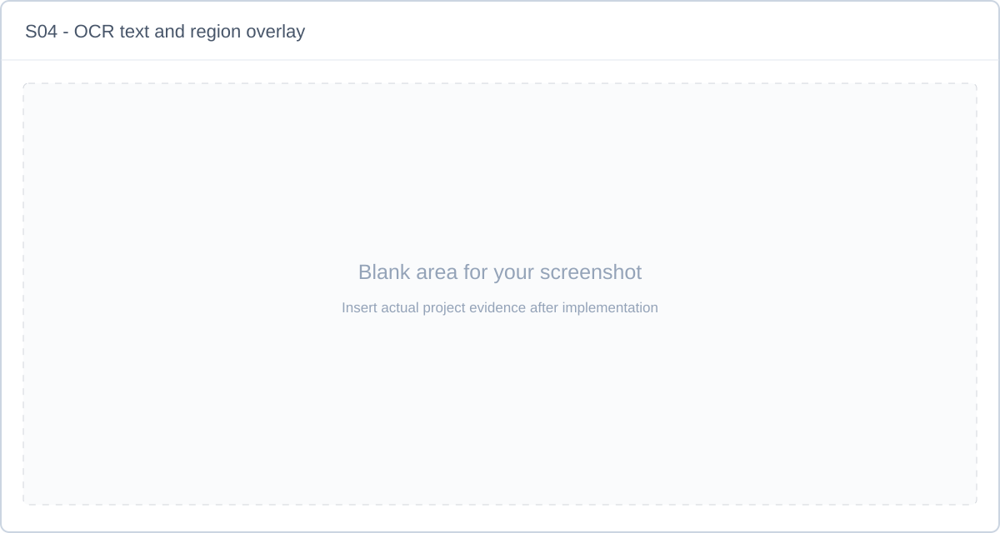

*Figure S04. Insert real OCR text and aligned regions; identify detector, recognizer and image frame in the caption.*

## 8. Rules baseline

The proposed baseline creates candidate spans before selecting fields. Company/address candidates use header context and line grouping. Dates use supported format patterns while preserving ambiguous alternatives. Total candidates use final-total labels and geometry, penalizing subtotal, cash, tendered and change contexts.

Rules retain selected region IDs, candidate reasons and ambiguity. Their heuristic scores are not calibrated probabilities. Rules and parser policies are developed on training/validation only and frozen before held-out evaluation.

## 9. LayoutLMv3 adaptation

The proposed learned extractor starts from `microsoft/layoutlmv3-base` [1], with a receipt token-classification head. External OCR is preserved and internal processor OCR disabled. Inputs are the selected RGB image, OCR units and 0-1000 normalized boxes referring to the same geometry.

### 9.1 Labels and encoding

Use `O` plus begin/inside tags for each of the four fields. Supervise first subwords under the proposed policy, ignoring continuation/special/padding/unresolved positions. Window long receipts with global OCR IDs so bottom fields are not lost; merge overlap under a frozen policy.

### 9.2 Training and selection

Complete an audited tiny overfit check before larger runs. Proposed initial settings are AdamW, learning rate 2e-5, weight decay 0.01, small measured microbatches, accumulation toward an effective batch around eight windows, and a bounded epoch budget with validation early stopping. Actual settings and hardware must replace these proposals in the final report.

| Training detail | Final value |
|---|---|
| Initial checkpoint + revision | PENDING |
| Dataset/split/annotation fingerprints | PENDING |
| Labels and subword/window policy | PENDING |
| Trainable/frozen parameters | PENDING |
| Optimizer, learning rate and schedule | PENDING |
| Batch, accumulation, precision and seed | PENDING |
| Epochs and selected checkpoint | PENDING |
| Hardware, peak memory and elapsed training time | PENDING |

**Screenshot S06 - Training and validation evidence**

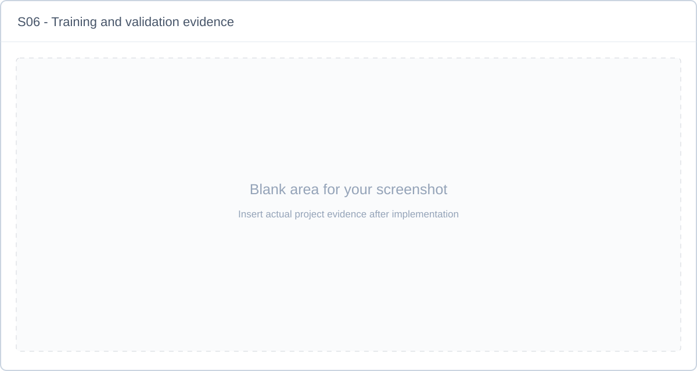

*Figure S06. Insert real logs/curves with run ID and validation selection criterion. Tiny-subset overfit results must not be presented as generalization accuracy.*

### 9.3 Field reconstruction

Map text outputs back to global OCR IDs, apply a documented BIO repair policy and construct candidate spans. Resolve or flag competing spans instead of concatenating unrelated predictions. Preserve raw strings and region evidence before shared normalization.

## 10. Validation, evidence and human correction

Dates and amounts are parsed conservatively. Ambiguous dates remain unresolved; money uses decimal arithmetic. Missing or conflicting fields generate review reasons. Raw OCR/model/rule scores retain named semantics rather than being presented as a single probability of correctness.

Users inspect selected regions, edit values, and explicitly confirm a reviewed record. Corrections preserve the automated prediction and event history. A typed correction can be labelled as user-entered without fabricated OCR evidence.

**Screenshot S09 - Selected field evidence**

*Figure S09. Insert an actual field selection and correctly aligned evidence. Note coarse line geometry if applicable.*

**Screenshot S10 - Uncertainty or missing-field state**

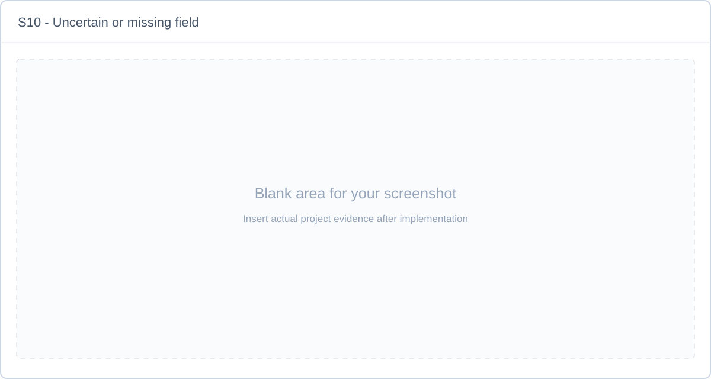

*Figure S10. Insert a genuine ambiguous/missing case and the displayed review reason.*

**Screenshot S11 - Before/after user correction**

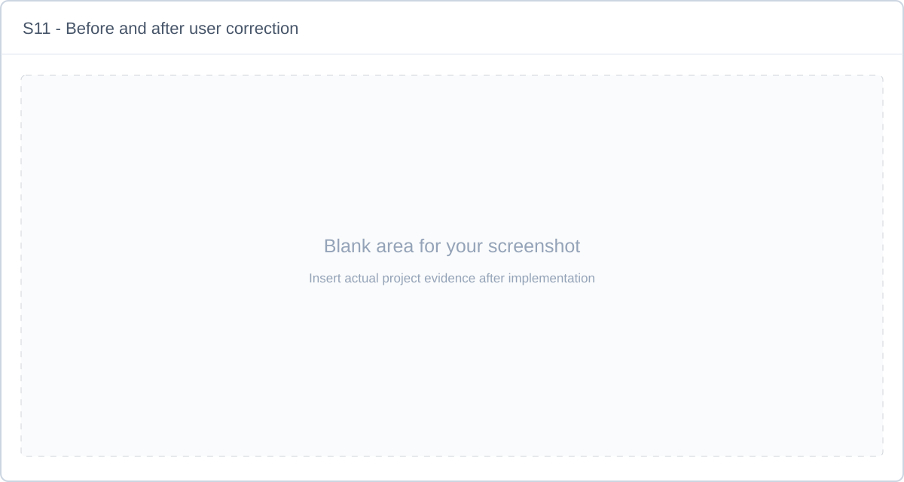

*Figure S11. Insert an actual edit and its review history. The corrected value is a human-reviewed output, separate from automated accuracy.*

## 11. Application and export

The proposed local Streamlit interface provides upload, preview, fields, evidence selection, review and download. A shared pipeline function supports offline runs. FastAPI is optional if a separate client/process boundary becomes necessary.

JSON exports retain schema version, IDs, raw/final values, review state and provenance. CSV exports use correct quoting, a declared encoding/null policy and spreadsheet-safe handling of formula-leading textual cells. Reviewed exports remain distinguishable from machine outputs.

**Screenshot S07 - Main application screen**

*Figure S07. Insert the real upload and receipt-preview interface.*

**Screenshot S08 - Extracted field table**

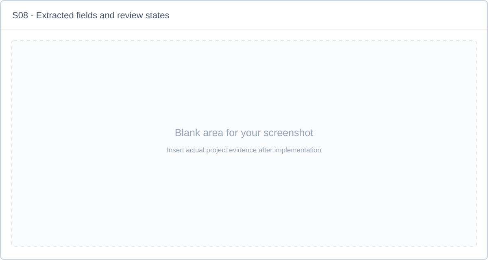

*Figure S08. Insert the actual four-field output with method name and review states.*

**Screenshot S12 - Structured export**

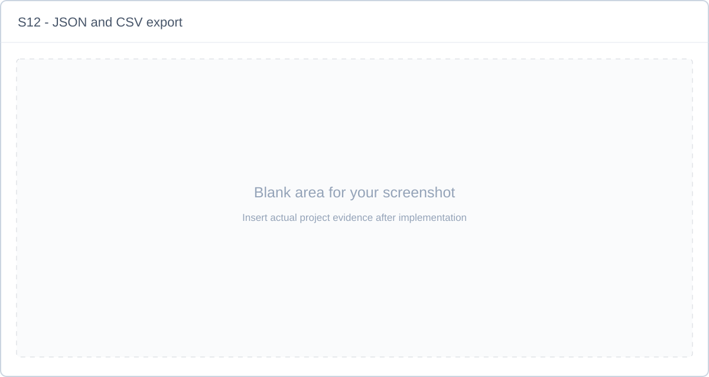

*Figure S12. Insert a real JSON/CSV export that matches the visible receipt and reviewed values.*

## 12. Experimental protocol

### 12.1 Main comparison

Compare rules and trained LayoutLMv3 using the same receipt IDs, OCR cache and shared validation. Primary scoring uses strict complete-field matching after declared Unicode/whitespace cleanup. Secondary normalized scoring may case-fold text and compare unambiguous parsed dates/decimal amounts. Prediction parse failures and missing outputs count as errors for labelled fields.

Per-field exact match is the number of completely correct fields divided by the predeclared evaluable field count. Macro field EM averages the four field scores. All-four EM requires all four fields on a receipt to be correct. These metrics are distinct from token/entity F1 and do not automatically match official competition scoring.

### 12.2 Ablations and robustness

Run raw-image rules/model comparisons and matching correction variants. State whether the learned checkpoint is fixed or retrained when changing preprocessing. Optional oracle OCR or explicit rule-override experiments are separately labelled. Evaluate a fixed blur/rotation/contrast/perspective grid without development on those final results.

### 12.3 Timing and uncertainty

Measure startup, uncached end-to-end and cached-OCR extraction separately. Record hardware, device, image sizes, warmups and sample counts; synchronize GPU timing where needed. Use paired receipt-level analysis and, if practical, bootstrap intervals or repeated training seeds.

### 12.4 Integrity controls

Freeze rules, checkpoint, parser/decoder, thresholds, metric policy and test IDs before final scoring. Save predictions before review. Retain failed receipts in the declared denominators. If test-driven changes are made, disclose them and use new confirmation data where feasible.

## 13. Results to be completed

**These tables preserve the original planning template. Executed results are in [IMPLEMENTATION_REPORT.md](IMPLEMENTATION_REPORT.md), generated from saved evidence. Replace template cells from those artifacts, or explicitly mark an unrun optional study “not evaluated”.**

### 13.1 Main strict field results

All rates should be reported consistently as proportions or percentages, with denominators and run IDs.

| Method | N receipts | Company EM | Address EM | Date EM | Total EM | Macro field EM | All-four EM | Run ID |
|---|---|---|---|---|---|---|---|---|
| Raw OCR + rules | PENDING | PENDING | PENDING | PENDING | PENDING | PENDING | PENDING | PENDING |
| Same OCR + LayoutLMv3 | PENDING | PENDING | PENDING | PENDING | PENDING | PENDING | PENDING | PENDING |
| Selected correction + rules | PENDING | PENDING | PENDING | PENDING | PENDING | PENDING | PENDING | PENDING |
| Same corrected OCR + LayoutLMv3 | PENDING | PENDING | PENDING | PENDING | PENDING | PENDING | PENDING | PENDING |

Report the same table or a linked artifact for secondary normalized scores, with the exact policy name. Do not merge strict and normalized values in one unlabeled score.

### 13.2 Paired comparison and variability

| Comparison | Metric | Difference, percentage points | Receipt count | Interval / seed variation |
|---|---|---|---|---|
| Learned minus rules, shared raw OCR | Macro field EM | PENDING | PENDING | PENDING |
| Learned minus rules, shared raw OCR | All-four EM | PENDING | PENDING | PENDING |
| Correction effect under declared checkpoint policy | Macro field EM | PENDING | PENDING | PENDING |

### 13.3 Robustness

| Condition and parameters | Parent receipts | Method/run | Macro field EM | All-four EM | Change from clean |
|---|---|---|---|---|---|
| Clean | PENDING | PENDING | PENDING | PENDING | Reference |
| Blur, declared strength | PENDING | PENDING | PENDING | PENDING | PENDING |
| Rotation, padded, declared angle | PENDING | PENDING | PENDING | PENDING | PENDING |
| Reduced contrast | PENDING | PENDING | PENDING | PENDING | PENDING |
| Perspective, declared transform | PENDING | PENDING | PENDING | PENDING | PENDING |

### 13.4 Latency and resources

| Condition | Hardware/device | N timed | Median | p95 | Failure rate / notes |
|---|---|---|---|---|---|
| Cold startup/model load | PENDING | PENDING | PENDING | PENDING | PENDING |
| Uncached rules pipeline | PENDING | PENDING | PENDING | PENDING | PENDING |
| Uncached learned pipeline | PENDING | PENDING | PENDING | PENDING | PENDING |
| Cached-OCR learned extraction | PENDING | PENDING | PENDING | PENDING | PENDING |

### 13.5 Review behavior

| Policy/run | Review rate | Error recall | Accuracy among unflagged | Confirmation/correction sample notes |
|---|---|---|---|---|
| Frozen validation-selected policy | PENDING | PENDING | PENDING | PENDING |

Human-corrected accuracy, if studied, requires an independent review protocol and must be reported separately from machine extraction.

**Screenshot S13 - Measured comparison/results**

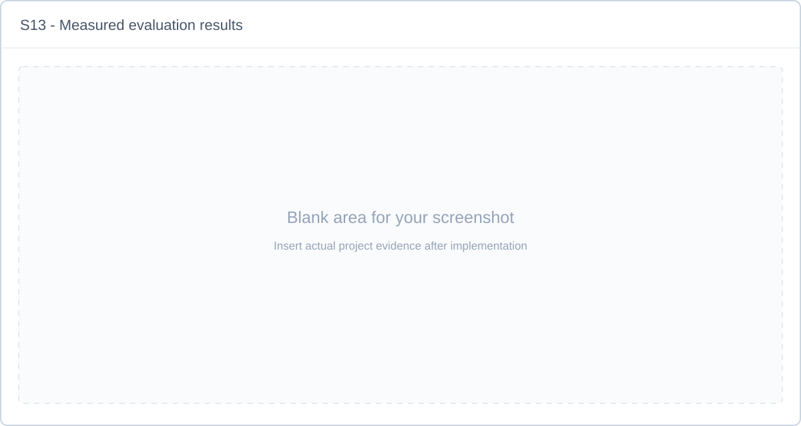

*Figure S13. Insert a real result table or plot, with run IDs, sample counts and metric policy.*

## 14. Error analysis and discussion

Inspect representative successes and failures. Classify errors by image preparation, detection, recognition, reading order, annotation, classification, decoding and normalization. Avoid attributing every final-field error to the transformer.

| Receipt/run | Reference versus prediction | Failure stage | Evidence | Interpretation |
|---|---|---|---|---|
| PENDING | PENDING | PENDING | PENDING | PENDING |
| PENDING | PENDING | PENDING | PENDING | PENDING |
| PENDING | PENDING | PENDING | PENDING | PENDING |

**Screenshot S14 - Representative failure case**

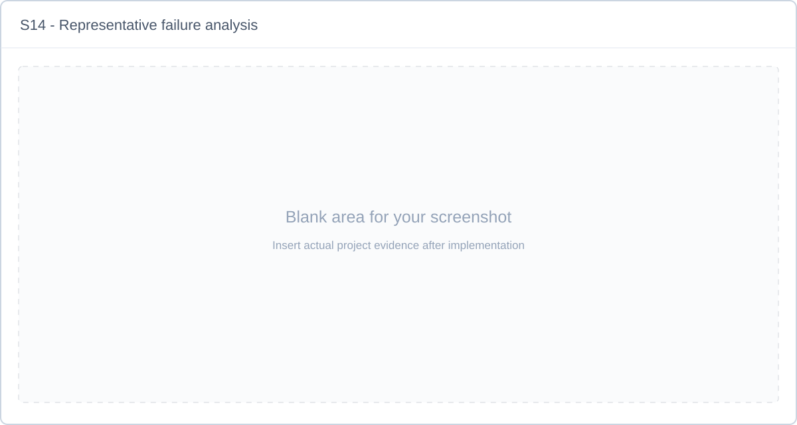

*Figure S14. Insert an actual failure with input, OCR/field evidence and reference. Explain the stage responsible and whether human review flagged it.*

After results exist, discuss: which method performed better, the size/uncertainty of the difference, hardest fields, OCR coverage limits, preprocessing tradeoffs, robustness losses and practical latency. If the learned model does not improve the baseline, report that finding and the supported explanation.

## 15. Limitations and future work

Expected limitations to evaluate include restricted dataset/domain coverage, noisy alignment-derived training labels, dependence on OCR quality, approximate line geometry, long-receipt context limits, uncertain confidence signals and training resource constraints. These are anticipated risks, not yet measured error frequencies.

Possible extensions include a controlled BROS comparison [6], an alternative recognizer such as TrOCR [7], an OCR-free system such as Donut [8], broader phone-photo/multilingual evaluation, richer receipt fields and a better-calibrated review policy. Each extension requires new supervision and fair evaluation; listing it does not imply implementation.

## 16. Current conclusion and finalization instructions

The present deliverable establishes a coherent ReceiptSense specification, a dependency-ordered implementation plan, relevant research sources, and a report structure. The proposed pipeline preserves OCR evidence while comparing transparent rules with learned extraction and supporting human review. Whether this design improves extraction quality remains an empirical question.

For final submission, replace this section with conclusions supported by the actual held-out results. State the dataset, compared conditions, strongest finding, principal failure mode, practical limit and measured resource requirements. Do not convert expected benefits into past-tense achievements without evidence.

## 17. References

1. Y. Huang, T. Lv, L. Cui, Y. Lu, F. Wei. **LayoutLMv3: Pre-training for Document AI with Unified Text and Image Masking.** ACM Multimedia, 2022. [Original](https://arxiv.org/abs/2204.08387) · [Imported PDF](../research/papers/P01_LayoutLMv3.pdf).
2. Z. Huang et al. **ICDAR2019 Competition on Scanned Receipt OCR and Information Extraction.** ICDAR, 2019; preprint 2021. [Original](https://arxiv.org/abs/2103.10213) · [Imported PDF](../research/papers/P02_SROIE.pdf).
3. M. Liao, Z. Wan, C. Yao, K. Chen, X. Bai. **Real-time Scene Text Detection with Differentiable Binarization.** AAAI, 2020. [Original](https://arxiv.org/abs/1911.08947) · [Imported PDF](../research/papers/P03_DBNet.pdf).
4. B. Shi, X. Bai, C. Yao. **An End-to-End Trainable Neural Network for Image-based Sequence Recognition and Its Application to Scene Text Recognition.** IEEE TPAMI, 2017; preprint 2015. [Original](https://arxiv.org/abs/1507.05717) · [Imported PDF](../research/papers/P04_CRNN.pdf).
5. Y. Xu et al. **LayoutLM: Pre-training of Text and Layout for Document Image Understanding.** KDD, 2020. [Original](https://arxiv.org/abs/1912.13318) · [Imported PDF](../research/papers/P05_LayoutLM.pdf).
6. T. Hong et al. **BROS: A Pre-trained Language Model Focusing on Text and Layout for Better Key Information Extraction from Documents.** AAAI, 2022. [Original](https://arxiv.org/abs/2108.04539) · [Imported PDF](../research/papers/P06_BROS.pdf).
7. M. Li et al. **TrOCR: Transformer-based Optical Character Recognition with Pre-trained Models.** AAAI, 2023; preprint 2021. [Original](https://arxiv.org/abs/2109.10282) · [Imported PDF](../research/papers/P07_TrOCR.pdf).
8. G. Kim et al. **OCR-free Document Understanding Transformer.** ECCV, 2022. [Original](https://arxiv.org/abs/2111.15664) · [Imported PDF](../research/papers/P08_Donut.pdf).
9. X. Mifsud, L. Grech, A. Baldacchino, L. Keller, G. Valentino, A. Muscat. **Receipt Information Extraction with Joint Multi-Modal Transformer and Rule-Based Model.** Machine Learning and Knowledge Extraction, 7(4), 167, 2025. [DOI](https://doi.org/10.3390/make7040167) · [Imported PDF](../research/papers/P09_Joint_Receipt_Model.pdf).

Implementation reference: [Transformers LayoutLMv3 guide](https://huggingface.co/docs/transformers/model_doc/layoutlmv3), [Microsoft checkpoint card](https://huggingface.co/microsoft/layoutlmv3-base), and [PaddleOCR pipeline guide](https://www.paddleocr.ai/main/en/version3.x/pipeline_usage/OCR.html). Final software revisions belong in the environment/run manifest.

## 18. Reproducibility and evidence checklist

- [ ] Actual dataset source/version/terms, counts and exclusions are documented.
- [ ] Split IDs, duplicate checks, annotation policy and coverage are saved.
- [ ] OCR/model/configuration revisions and environment lock are available.
- [ ] Training logs, selected checkpoint and selection criterion are recorded.
- [ ] Strict/normalized metrics and failure denominators are reproducible.
- [ ] Prediction files remain separate from reviews and corrections.
- [ ] All result tables identify runs and contain no unmarked placeholder values.
- [ ] S01-S14 contain genuine evidence and matching captions, or an explicit omitted/not-applicable explanation.
- [ ] No blank image is described as a completed experiment.
- [ ] An independent session can run the demo and recreate the claimed summary.
- [ ] Conclusions reflect only measured evidence.
